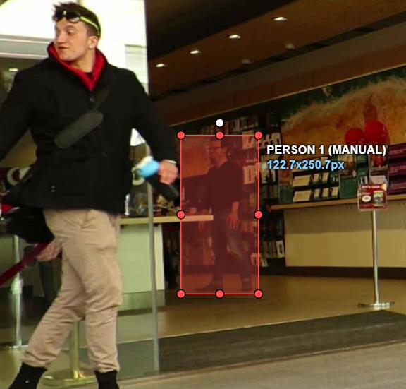
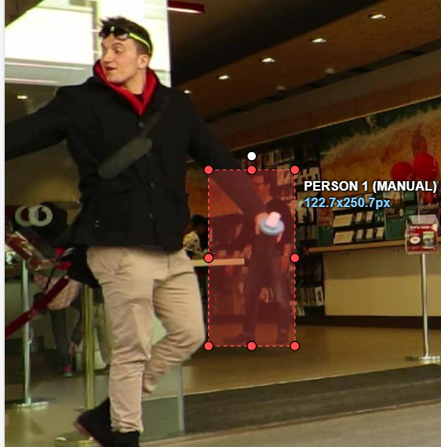
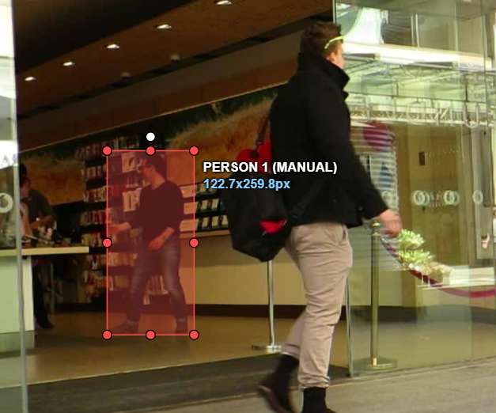

# Báo cáo cá nhân — Đinh Hồng Hải - 2A202603096

Đoạn video: MOT17-09, 150 frame (frame 1–150), nguồn MOTChallenge, giấy phép CC BY-NC-SA 3.0.

## 0. Thông tin học viên

- Họ tên: Đinh Hồng Hải
- MSSV: 2A202603096
- Mã đề (A/B/C): B
- Email: 26ai.haidh3@vinuni.edu.vn
- Link repository: https://github.com/DHHai313/K5-L2A-DinhHongHai-03096-MOTTracking.git
- Giờ bắt đầu: 16:00
- Giờ kết thúc: 18:30

## 1. Xem trước đoạn video (CP0)

Ghi **trước khi vẽ**, mỗi người một dòng.

| Mã  | Frame xuất hiện | Frame cuối thấy được | Rẽ / dừng / đổi tốc độ ở frame     | Bị che ở frame               | Ghi chú                               |
| --- | --------------- | -------------------- | ---------------------------------- | ---------------------------- | ------------------------------------- |
| P1  | 001             | 150                  | 95                                 | 25                           | Bị che 1 phần sau đó bị che hoàn toàn |
| P2  | 061             | 150                  | 102                                | 61                           | Bị che 1 phần từ lúc xuất hiện        |
| P3  | 001             | 150                  | Đi thẳng không rẽ không đổi tốc độ | Không bị che                 | Không                                 |
| P4  | 001             | 150                  | Đi thẳng không rẽ không đổi tốc độ | Bị che ở frame đầu xuất hiện | Không                                 |
| P5  | 001             | 147                  | 50                                 | 111                          | Bị 2 người che                        |

## 2. Keyframe và thời gian (CP1, CP4)

Số keyframe lấy từ kết quả `src/check_submission.py`.

| Mã       | Số keyframe | Keyframe ở frame                                                                                                                                                                  | Số frame có mặt | Keyframe / 100 frame | Thời gian (phút) | Chỗ khó                                                                                            |
| -------- | ----------- | --------------------------------------------------------------------------------------------------------------------------------------------------------------------------------- | --------------- | -------------------- | ---------------- | -------------------------------------------------------------------------------------------------- |
| P1       | 28          | 0, 10, 14, 18, 24, 34, 39, 40, 44, 45, 47, 49, 53, 55, 61, 64, 69, 77, 85, 87, 101, 103, 121, 128, 129, 137, 140, 145                                                             | 147             | 19.0                 | 25               | Bị P2 che khuất một phần rồi mất hẳn trong shop Vodafone, rẽ và đổi kích thước                     |
| P2       | 18          | 60, 67, 74, 78, 79, 82, 86, 89, 91, 93, 99, 103, 105, 116, 126, 136, 146, 149                                                                                                     | 90              | 20.0                 | 20               | Xuất hiện muộn ở frame 60 (CVAT), bị che một phần ngay từ đầu, rẽ ở frame 102                      |
| P3       | 42          | 0, 10, 20, 30, 40, 50, 60, 65, 67, 68, 69, 70, 71, 73, 75, 76, 77, 78, 79, 80, 81, 82, 83, 84, 85, 86, 87, 88, 89, 90, 100, 104, 108, 110, 120, 122, 125, 130, 132, 134, 140, 149 | 150             | 28.0                 | 25               | Đi thẳng nhưng cần nhiều keyframe ở giữa (frame 65–90) để căn chỉnh box khớp chính xác             |
| P4       | 16          | 0, 10, 20, 30, 40, 50, 60, 70, 80, 90, 100, 110, 120, 130, 140, 149                                                                                                               | 150             | 10.7                 | 15               | Bị che khuất một phần trong nhiều frame (70 frame occluded), cần duy trì amodal box                |
| P5       | 10          | 0, 10, 20, 30, 40, 105, 135, 140, 141, 142                                                                                                                                        | 122             | 8.2                  | 15               | Bị che hoàn toàn 2 lần bởi 2 người khác (đoạn vắng 110–134 bật outside), ra khỏi khung ở frame 146 |
| **Tổng** | 114         | —                                                                                                                                                                                 | 659             | 17.3                 | 95               | —                                                                                                  |

Keyframe / 100 frame của cả bài = tổng keyframe ÷ tổng số frame có mặt × 100 = 114 ÷ 659 × 100 = 17.3 keyframe / 100 frame.

Bạn đặt keyframe nhiều nhất ở người nào? Vì sao (người đó rẽ, dừng, lại gần camera hay bị che)?

Em đặt keyframe nhiều nhất ở **P3** (42 keyframe) và **P1** (28 keyframe).

- Đối với **P1**: Do người này di chuyển bên trong shop Vodafone, bị Person 2 che khuất (phải cắm keyframe dày quanh các mốc bắt đầu che, mất hẳn, hiện lại và đổi hướng ở frame 95).
- Đối với **P3**: Do người này di chuyển liên tục, ở đoạn giữa video (từ frame 65 đến 90) khi bước đi có sự thay đổi nhẹ về dáng và tốc độ, em đã chèn thêm nhiều keyframe để đảm bảo bounding box luôn bám thật khít gót chân và đỉnh đầu, không để box bị trôi (drift).

## 3. Đoạn bị che (CP2)

Người bị che: `P1`

| Mốc                                      | Frame |
| ---------------------------------------- | ----: |
| Bắt đầu bị che một phần (bật `occluded`) |    24 |
| Mất hẳn (bật `outside`)                  |    41 |
| Hiện lại (tắt `outside`)                 |    44 |
| Thấy rõ trở lại (tắt `occluded`)         |    55 |

- Thời gian khuất hẳn: **3 frame = 0.10 giây** (ở tốc độ 30 fps).
- Quyết định: **Giữ cùng ID (Track ID 1)**.
- Lý do (trả lời 3 câu: khuất bao lâu so với 60 frame, ngoại hình có khớp, chỗ hiện lại có đúng hướng và tốc độ):
    1. _Thời gian khuất:_ P1 chỉ bị che khuất hoàn toàn trong 3 frame (từ frame 41 đến 43 trên CVAT, tương đương 0.10 giây), ngắn hơn rất nhiều so với ngưỡng 60 frame (2 giây) của lớp.
    2. _Ngoại hình:_ Khi xuất hiện trở lại ở frame 44, đối tượng hoàn toàn trùng khớp về đặc điểm nhận dạng (người đàn ông mặc áo len đen, quần tối màu bên trong cửa hàng Vodafone).
    3. _Hướng đi và tốc độ:_ Vị trí xuất hiện lại tiếp tục hành trình bước sang bên phải với vận tốc và sải bước hoàn toàn logic so với trước khi bị che. Do đó, việc duy trì cùng một Track ID là chính xác theo chuẩn GT.

Ảnh chụp màn hình:





## 4. Tự review ID (CP3)

Lượt 1 theo người (đi ngược từ frame 149 về 0 trên CVAT), lượt 2 theo cảnh (nhảy 10 frame). Ít nhất 3 dòng; không có lỗi thì ghi một dòng "đã kiểm hai lượt, không lỗi".

Loại lỗi dùng đúng một trong 7 mã: `id_switch`, `fragmentation`, `lost`, `merge`, `false_track`, `drift`, `flag`.

| Frame | Mã người | Loại lỗi | Mô tả một câu                                      | Phát hiện ở lượt | Đã sửa?                            |
| ----: | -------- | -------- | -------------------------------------------------- | ---------------- | ---------------------------------- |
|    42 | P1       | flag     | Chưa bật cờ outside khi P1 bị che hoàn toàn        | Lượt 1           | Có (đã bật outside từ frame 41–43) |
|    70 | P3       | drift    | Box bị trôi nhẹ chân chạm đất do nội suy bước chân | Lượt 1           | Có (đã thêm keyframe tại frame 70) |
|   110 | P5       | flag     | Bị người khác che lấp nhưng box vẫn giữ nguyên     | Lượt 2           | Có (đã bật outside đoạn 110–134)   |

Tổng hợp số lỗi theo loại:

| `id_switch` | `fragmentation` | `lost` | `merge` | `false_track` | `drift` | `flag` |
| ----------: | --------------: | -----: | ------: | ------------: | ------: | -----: |
|           0 |               0 |      0 |       0 |             0 |       1 |      2 |

Lỗi nào chỉ lượt 2 (theo cảnh) mới thấy, lượt 1 (theo người) không thấy? Vì sao?

Các lỗi tương tác đa đối tượng như **`id_switch`** (hoán đổi ID) hoặc **`merge`** (một hộp bao gộp cả 2 người đi sát nhau) thường chỉ có lượt 2 (theo cảnh tổng thể) mới phát hiện được. Nguyên nhân là ở lượt 1, khi chỉ tập trung nhìn theo một người di chuyển, mắt người dễ bị cuốn theo đối tượng mới mà không nhận ra box đã vô tình nhảy sang người đi bên cạnh; trong khi ở lượt 2, việc quan sát toàn bộ các box đồng thời tại các giao điểm người đi cắt nhau sẽ dễ dàng thấy ngay sự bất thường về ID hoặc việc thiếu/thừa box.

## 5. File xuất và kết quả tự kiểm (CP4)

| Kiểm tra                                                  | Kết quả                                                    |
| --------------------------------------------------------- | ---------------------------------------------------------- |
| Tên file MOT 1.1                                          | DinhHongHai_mot.zip                                        |
| Tên file CVAT for video 1.1                               | DinhHongHai_cvat_video.zip                                 |
| Số track ID khác nhau trong `gt/gt.txt` (phải là 5)       | 5                                                          |
| Frame `outside` không có dòng trong `gt.txt` (đúng / sai) | Đúng (đoạn 41–43 của P1 và 110–134 của P5 không sinh dòng) |
| Job đã completed trên CVAT máy cá nhân                    | Đúng                                                       |

Dán phần tóm tắt in ra từ `src/check_submission.py`:

```text
Số frame in theo CVAT (bắt đầu từ 0). Trong gt.txt, frame_id = frame CVAT + 1.

=== File MOT 1.1: DinhHongHai_mot.zip ===
  Số track ID: 5   |   Tổng số box: 659
  [OK]        Đúng 5 track ID.

  Track | Frame có mặt | Số frame | Đoạn vắng (outside)
      1 |   0–149      |      147 | 41–43
      2 |   0–149      |      150 | -
      3 |   0–149      |      150 | -
      4 |   0–146      |      122 | 110–134
      5 |  60–149      |       90 | -


=== File CVAT for video 1.1: DinhHongHai_cvat_video.zip ===

  Track | Nhãn   | Frame thấy | Keyframe | KF/100 frame | Frame occluded | Lần bật outside
      0 | person |        147 |       28 |         19.0 |             28 |               1
              Track 0: keyframe ở frame [0, 10, 14, 18, 24, 34, 39, 40, 44, 45, 47, 49, 53, 55, 61, 64, 69, 77, 85, 87, 101, 103, 121, 128, 129, 137, 140, 145]
      1 | person |         90 |       18 |         20.0 |             33 |               0
              Track 1: keyframe ở frame [60, 67, 74, 78, 79, 82, 86, 89, 91, 93, 99, 103, 105, 116, 126, 136, 146, 149]
      2 | person |        150 |       42 |         28.0 |              0 |               0
              Track 2: keyframe ở frame [0, 10, 20, 30, 40, 50, 60, 65, 67, 68, 69, 70, 71, 73, 75, 76, 77, 78, 79, 80, 81, 82, 83, 84, 85, 86, 87, 88, 89, 90, 100, 104, 108, 110, 120, 122, 125, 130, 132, 134, 140, 149]
      3 | person |        150 |       16 |         10.7 |             70 |               0
              Track 3: keyframe ở frame [0, 10, 20, 30, 40, 50, 60, 70, 80, 90, 100, 110, 120, 130, 140, 149]
      4 | person |        122 |       10 |          8.2 |             17 |               2
              Track 4: keyframe ở frame [0, 10, 20, 30, 40, 105, 135, 140, 141, 142]

  Tổng: 114 keyframe / 659 frame có mặt = 17.3 keyframe / 100 frame
  [OK]        Đọc được 5 track từ annotations.xml.

=== Tóm tắt ===
  Lỗi: 0   |   Cảnh báo: 0
  Đạt. Dán phần tóm tắt này vào báo cáo mục 5.
```

## 6. Ba câu kết

1. **Nếu được gán lại, bạn sẽ đặt keyframe khác ở đâu? Vì sao?**

    Nếu được gán lại, em sẽ tối ưu hóa số lượng keyframe ở **P3** (hiện tại là 42 keyframe, tỷ lệ 28 keyframe/100 frame). Do P3 chủ yếu đi thẳng đều, ở đoạn giữa em có thể giãn khoảng cách keyframe ra từ 10–15 frame thay vì cắm liên tiếp nhiều frame (frame 65–90). Việc này giúp tiết kiệm đáng kể thời gian gán nhãn mà vẫn đảm bảo độ mượt mà của nội suy tuyến tính, tránh nguy cơ gây rung giật bounding box.

2. **Có chỗ nào bạn không chắc "cùng ID hay ID mới"? Bạn đã quyết định và ghi chú thế nào?**

    Đoạn phân vân nhất là khi **P5 bị che khuất từ frame 110 đến 134** (khoảng 25 frame) và khi **P1 bị che hoàn toàn bởi P2** (frame 41–43). Em đã áp dụng quy tắc 3 bước của guideline: (1) Thời gian khuất ngắn (< 60 frame = 2 giây); (2) Ngoại hình khi lộ diện hoàn toàn khớp về quần áo và vóc dáng; (3) Điểm xuất hiện lại hoàn toàn ăn khớp với hướng đi và tốc độ trước đó. Do đó em quyết định giữ nguyên cùng Track ID (tắt `outside` trên track cũ thay vì tạo track mới) và ghi chú rõ ràng vào báo cáo.

3. **Một lỗi ID trong job của bạn (nếu không còn sót, chọn lỗi đã sửa) có thể làm xe tự lái dự đoán sai chuyển động của người đó như thế nào? Lỗi đó ảnh hưởng MOTA hay IDF1 nhiều hơn?**
    - _Tác động tới xe tự lái:_ Nếu xảy ra lỗi **`id_switch`** (hoán đổi ID) hoặc mất dấu rồi tạo track mới, bộ ước lượng trạng thái (như Kalman Filter) trong hệ thống xe tự lái sẽ tính toán vận tốc tức thời dựa trên vị trí của 2 frame liên tiếp bị nhảy cóc sang tọa độ của người khác. Điều này tạo ra một "vector vận tốc ảo" cực lớn (ví dụ nhảy 1.5m trong 1/30 giây tương đương ~162 km/h). Xe tự lái sẽ dự đoán sai hoàn toàn quỹ đạo di chuyển (trajectory prediction) của người đi bộ, dẫn đến việc phanh gấp oan hoặc đánh lái đột ngột gây nguy hiểm cho hành khách và các phương tiện xung quanh.
    - _Ảnh hưởng MOTA vs IDF1:_ Lỗi này ảnh hưởng đến **IDF1 nhiều hơn rất nhiều so với MOTA**. MOTA chỉ tính lỗi cục bộ theo từng frame (1 lần `IDSW` chỉ làm giảm nhẹ 1 điểm trong tổng số hàng trăm frame detection). Ngược lại, IDF1 đo lường tính liên tục định danh trên toàn bộ chuỗi: khi 1 người bị chia thành 2 ID khác nhau, toàn bộ nửa sau của track sẽ bị tính là sai định danh, khiến chỉ số IDF1 sụt giảm nghiêm trọng.

## 7. Tài liệu tham khảo và công cụ AI đã dùng

- CVAT Documentation: https://docs.cvat.ai/
- MOTChallenge Guidelines (Milan et al., 2016).
- Trợ lý AI Antigravity: Tra cứu và giải thích các khái niệm MOTA, IDF1, quy chuẩn Amodal Bounding Box, và hỗ trợ rà soát cấu trúc báo cáo.
